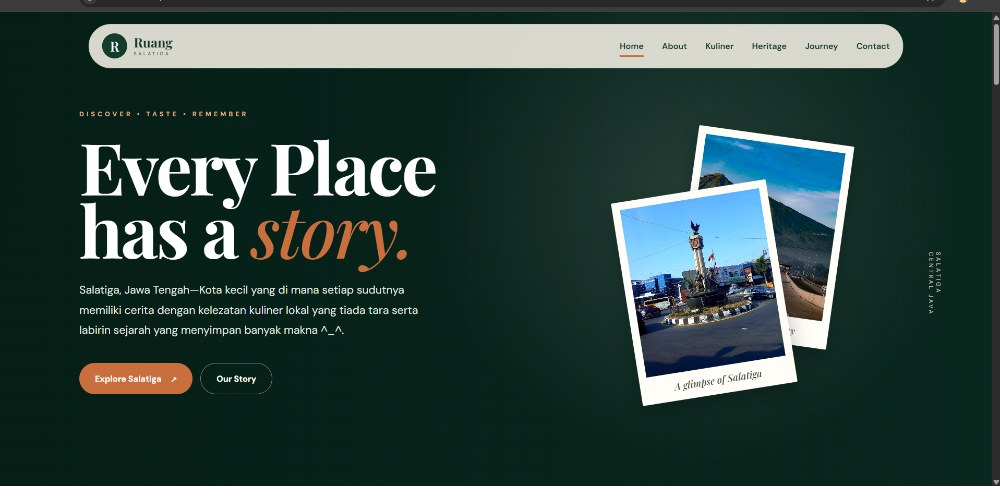

# Ruang-Salatiga

## Tampilan Website



# Ruang Salatiga — Discover, Taste, Remember

Website Ruang Salatiga merupakan platform yang memperkenalkan kuliner lokal, tempat wisata, dan lokasi bersejarah di Kota Salatiga, Jawa Tengah. Website ini juga bertujuan membantu memperkenalkan UMKM kuliner lokal agar lebih dikenal oleh masyarakat luas.

## 👥 Nama Peserta

1. Reva Fitriani
2. Salwa Rifki Wahyuningtyas

## 📌 Deskripsi Website

Website ini dibuat sebagai media informasi dan eksplorasi kuliner lokal, tempat wisata, hotel atau penginapan dan bersejarah di Kota Salatiga. Melalui website ini, pengunjung dapat mengenal makanan khas, menemukan informasi lokasi kuliner lokal, mengetahui tempat bersejarah, serta menjelajahi keunikan Salatiga dalam satu platform.

Dengan konsep **“Discover, Taste, Remember”**, website ini menyediakan informasi mengenai kuliner lokal, lokasi UMKM, Tempat penginapan, serta tempat wisata dan bersejarah di Salatiga melalui tampilan yang menarik dan mudah digunakan. Website ini diharapkan dapat membantu pengunjung menemukan berbagai potensi lokal sekaligus mendukung pengenalan UMKM kuliner tradisional kepada masyarakat luas.

## 🎯 Tujuan Website

- Memperkenalkan kuliner lokal dan makanan khas Kota Salatiga.
- Menyediakan informasi mengenai lokasi kuliner dan UMKM lokal.
- Memperkenalkan tempat wisata, tempat bersejarah, dan destinasi budaya di Salatiga.
- Memudahkan pengunjung dalam menemukan informasi mengenai potensi lokal Salatiga.
- Mendukung promosi kuliner dan destinasi lokal melalui media digital.

## 🛠️ Teknologi yang Digunakan

- **HTML5** — membangun struktur halaman website.
- **CSS3** — mengatur tampilan, tata letak, dan responsivitas website.
- **JavaScript** — mendukung interaksi dan fungsionalitas website.
- **Google Fonts** — menggunakan font DM Sans dan Playfair Display untuk memperkuat tampilan visual.

## 📂 Struktur Folder

```text
Ruang-salatiga/
├── README.md
├── index.html
├── detail.html
├── css/
│   ├── detail.css
│   └── style.css
├── img/
│   ├── banteng.jpg
│   ├── enting.jpg
│   ├── keleteng.jpg
│   ├── koyor.jpg
│   ├── omah.kriya.jpg
│   ├── pasar.jpg
│   ├── salatiga.jpg
│   ├── sate.jpg
│   └── tol.jpg
├── js/
│   ├── detail.js
│   └── script.js
└── screenshots/
    └── home.png
```

### Penjelasan Struktur Folder

- `README.md` — dokumentasi proyek.
- `index.html` — halaman utama website.
- `detail.html` — halaman detail informasi.
- `css/` — menyimpan file CSS untuk mengatur tampilan website.
- `img/` — menyimpan gambar kuliner, tempat wisata, dan lokasi yang ditampilkan pada website.
- `js/` — menyimpan JavaScript untuk mengatur interaksi dan fungsionalitas website.
- `screenshots/` — menyimpan tangkapan layar tampilan website.
- `.vscode/` — menyimpan konfigurasi editor Visual Studio Code.

## ✨ Fitur Website

**Home** — Halaman utama dengan slogan “Every taste has a story” dan deskripsi singkat.

**About** — Mengenalkan cerita dan identitas Ruang Salatiga.

**Kuliner** — Menampilkan rekomendasi kuliner lokal Salatiga dengan detail informasi dan lokasi.

**Heritage** — Memperkenalkan tempat bersejarah dan destinasi dengan detail informasi dan lokasi.
**stay** - Memberikan informasi dan rekomendasi hotel atau penginapan yang terdapat di Salatiga.

**The Journey** — Memberikan rekomendasi pengalaman menjelajahi Salatiga.

**Contact** — Bagi yang ingi melakukan kolaborasi/mempromosikan produknya di website bisa menghubungi melalui email.

## 🚀 Cara Menjalankan Website

1. Clone atau unduh repository proyek ke komputer.
2. Buka folder proyek menggunakan Visual Studio Code.
3. Pastikan seluruh file HTML, CSS, JavaScript, dan gambar berada pada struktur folder yang sesuai.
4. Buka file `index.html` melalui browser atau gunakan ekstensi **Live Server** pada Visual Studio Code.
5. Jelajahi halaman dan fitur yang tersedia pada website.

## 🌱 Manfaat Website

Ruang Salatiga diharapkan dapat menjadi media digital untuk memperkenalkan kekayaan kuliner, UMKM lokal, tempat wisata, dan lokasi bersejarah di Kota Salatiga. Dengan informasi yang disajikan dalam satu platform, pengunjung dapat lebih mudah mengenal potensi lokal Salatiga dan menemukan tempat yang ingin dikunjungi.


---

**Ruang Salatiga — Discover • Taste • Remember**
